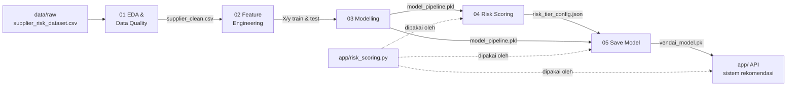

# Capstone-Project---VendAI

VendAI adalah sistem rekomendasi vendor berbasis risiko. Setiap vendor dinilai dari dua sisi:

- **Faktor operasional**: probabilitas risiko dari model machine learning (`Risk_Score`).
- **Faktor teknis**: aturan bisnis pada metrik pengiriman, kualitas, dan riwayat gangguan.

Gabungan kedua faktor menghasilkan **Risk Tier** (Rendah / Sedang / Tinggi) beserta alasan per vendor. Hasil ini menjadi dasar rekomendasi.

---

## Daftar Isi


---

## Gambaran Alur Sistem



Secara ringkas:

1. Data supplier dibersihkan (duplikat dihapus, missing value dipertahankan untuk diimputasi nanti).
2. Data dibagi menjadi train dan test secara stratified.
3. Model klasifikasi dilatih di dalam satu `Pipeline` scikit-learn (imputasi → scaling → model) untuk memprediksi `Risk_Level`.
4. Probabilitas dari model digabung dengan aturan teknis untuk menentukan Risk Tier.
5. Model, konfigurasi aturan, dan metadata dikemas dalam satu artefak yang siap dimuat oleh API.

---

## Struktur Proyek

```
Capstone-Project---VendAI/
├── app/
│   ├── main.py              # Endpoint FastAPI /recommend (masih stub)
│   ├── ranking.py           # Logika ranking vendor (masih stub)
│   ├── schemas.py           # Skema request/response API
│   └── risk_scoring.py      # Logika penentuan Risk Tier (dipakai notebook & API)
├── data/
│   ├── raw/                 # Dataset asli
│   └── processed/           # Output notebook 01 & 02 (di-ignore git)
├── models/
│   └── v1/
│       ├── model_pipeline.pkl      # Pipeline terlatih (notebook 03)
│       ├── risk_tier_config.json   # Aturan Risk Tier (notebook 04)
│       └── vendai_model.pkl        # Artefak final untuk deploy (notebook 05)
├── notebooks/
│   ├── 01_eda_data_quality.ipynb
│   ├── 02_feature_engineering.ipynb
│   ├── 03_modelling.ipynb
│   ├── 04_risk_scoring.ipynb
│   └── 05_save_model.ipynb
└── requirements.txt
```

---

## Dataset

Sumber: `data/raw/supplier_risk_dataset.csv`, berisi 27.388 baris dan 11 kolom.

| Kolom | Keterangan | Peran di sistem |
|---|---|---|
| `Supplier_ID` | Pengenal vendor | Disimpan terpisah untuk memetakan hasil, **bukan fitur** |
| `Financial_Stability_Score` | Skor stabilitas keuangan (0–100) | Fitur model |
| `Alternative_Suppliers_Available` | Jumlah supplier alternatif (0–5) | Fitur model |
| `Environmental_Compliance` | Skor kepatuhan lingkungan | Fitur model |
| `Contract_Length_Months` | Lama kontrak (bulan) | Fitur model |
| `On_Time_Delivery_Rate` | Persentase pengiriman tepat waktu (50–100) | Fitur model + aturan teknis |
| `Defect_Rate` | Persentase produk cacat (0–10) | Fitur model + aturan teknis |
| `Lead_Time_Days` | Waktu tunggu pengiriman (7–120 hari) | Fitur model + aturan teknis |
| `Previous_Disruptions` | Jumlah gangguan sebelumnya (0–5) | Fitur model + aturan teknis |
| `Geopolitical_Risk_Index` | Indeks risiko geopolitik (0–100) | **Tidak digunakan** |
| `Risk_Level` | Target: `1` = berisiko, `0` = tidak berisiko | Label |

---

## Cara Kerja per Tahap

### 01 — EDA & Data Quality (`01_eda_data_quality.ipynb`)

| Pemeriksaan | Temuan | Keputusan |
|---|---|---|
| Duplikasi | 27.388 baris, hanya 24.112 `Supplier_ID` unik | Satu baris per ID (`groupby('Supplier_ID').first()`) → 24.112 baris |
| Missing value | < 1,5% per kolom | Tidak di-drop (akan membuang ~7% baris). Diimputasi median **setelah split** |
| Outlier | Nilai ekstrem masih dalam rentang wajar | Dibiarkan |
| Distribusi target | 70% `Risk_Level = 1`, 30% `= 0` | Gunakan `stratify`, `class_weight='balanced'`, metrik F1 dan ROC-AUC |
| Korelasi dengan target | `Financial_Stability_Score` −0,51, `Geopolitical_Risk_Index` +0,30, `Alternative_Suppliers_Available` −0,25, `Environmental_Compliance` −0,23 | Korelasi antar fitur sangat rendah (maks 0,04), jadi tidak ada multikolinearitas |

Output: `data/processed/supplier_clean.csv`.

### 02 — Feature Engineering (`02_feature_engineering.ipynb`)

- `Supplier_ID` disisihkan sebagai `ids`. `Geopolitical_Risk_Index` dan `Risk_Level` dikeluarkan dari fitur.
- Train-test split 80/20 dengan `stratify=y` dan `random_state=42` → **19.289 baris train** dan **4.823 baris test**, proporsi 70/30 terjaga.
- `ids` ikut di-split dengan urutan acak yang sama, sehingga `id_test` tetap sejajar dengan `X_test`.
- Data disimpan **mentah** (masih ada NaN, belum di-scale). Imputasi dan scaling sengaja dilakukan di dalam pipeline model agar:
  - statistik preprocessing hanya dihitung dari data train (tanpa data leakage), dan
  - preprocessing yang sama otomatis diterapkan pada data vendor baru saat deploy.

Output: `X_train.csv`, `X_test.csv`, `y_train.csv`, `y_test.csv`, dan `id_test.csv` di `data/processed/`.

### 03 — Modelling (`03_modelling.ipynb`)

**Pipeline**

```
SimpleImputer(strategy='median') → StandardScaler() → Model
```

**Perbandingan model** (5-fold `StratifiedKFold`, data train saja):

| Model | F1 | ROC-AUC |
|---|---|---|
| HistGradientBoosting | 0,890 | **0,933** |
| RandomForest | **0,901** | 0,930 |
| LogisticRegression | 0,877 | 0,922 |

Semua model memakai `class_weight='balanced'`. **HistGradientBoosting** dipilih karena ROC-AUC-nya tertinggi. ROC-AUC paling relevan karena sistem mengurutkan vendor berdasarkan probabilitas risiko.

**Tuning** dengan `GridSearchCV` (108 kombinasi, scoring ROC-AUC). Parameter terbaik: `learning_rate=0.05`, `max_iter=300`, `max_leaf_nodes=10`, `min_samples_leaf=20`, dengan ROC-AUC CV 0,935.

**Evaluasi**

| Data | ROC-AUC | F1 (kelas 1) | Precision / Recall kelas 0 | Precision / Recall kelas 1 |
|---|---|---|---|---|
| Train | 0,948 | 0,90 | 0,73 / 0,89 | 0,95 / 0,86 |
| Test | **0,934** | **0,89** | 0,72 / 0,86 | 0,93 / 0,85 |

Selisih train dan test kecil, dan skor test hampir sama dengan skor CV, jadi model tidak overfit.

**Fitur paling berpengaruh** (permutation importance pada data test, penurunan ROC-AUC):

| Fitur | Importance |
|---|---|
| Financial_Stability_Score | 0,283 |
| Alternative_Suppliers_Available | 0,095 |
| Environmental_Compliance | 0,077 |
| Contract_Length_Months | 0,020 |
| Previous_Disruptions | 0,016 |
| On_Time_Delivery_Rate | 0,007 |
| Defect_Rate | 0,001 |
| Lead_Time_Days | 0,001 |

Model hampir sepenuhnya bertumpu pada faktor keuangan dan rantai pasok. Metrik teknis (`Defect_Rate`, `Lead_Time_Days`, dan lainnya) nyaris tidak dipakai model, karena di dataset ini label `Risk_Level` tidak ditentukan oleh metrik tersebut. Metrik teknis tetap dipertahankan sebagai fitur, dan pengaruhnya pada rekomendasi diberikan lewat **aturan teknis** di tahap 04.

Output: `models/v1/model_pipeline.pkl`.

### 04 — Risk Scoring (`04_risk_scoring.ipynb`)

Menentukan Risk Tier dari prediksi model dan aturan teknis. Logikanya ada di `app/risk_scoring.py` (lihat [Penentuan Risk Tier](#penentuan-risk-tier)).

Output: `models/v1/risk_tier_config.json`.

### 05 — Save Model (`05_save_model.ipynb`)

1. Memuat pipeline (notebook 03) dan konfigurasi tier (notebook 04).
2. Menghitung metrik final di data test: ROC-AUC 0,9341, F1 0,8925.
3. Mengemas semuanya ke `models/v1/vendai_model.pkl`.
4. **Verifikasi**: artefak dimuat ulang dari file, lalu dipastikan dengan `assert` bahwa prediksinya identik dengan pipeline asli.
5. **Simulasi vendor baru**: tiga vendor fiktif dengan data mentah, nilai kosong, dan kolom tambahan. Hasilnya dipastikan dengan `assert` sesuai kriteria tier: Rendah, Sedang, Tinggi.

---

## Penentuan Risk Tier

Fungsi: `assign_risk_tier(pipeline, df, config)` di `app/risk_scoring.py`.

### Dua faktor penilaian

**Faktor operasional (dari model)**
`Risk_Score = predict_proba(...)[:, 1]`. Faktor ini dinilai **kurang baik** jika `Risk_Score ≥ operational_threshold` (0,5).

**Faktor teknis (dari aturan)**
Faktor ini dinilai **kurang baik** jika vendor gagal minimal `min_tech_fails` (2) dari kriteria berikut:

| Kriteria | Gagal jika |
|---|---|
| `On_Time_Delivery_Rate` | < 80 |
| `Defect_Rate` | > 3,5 |
| `Lead_Time_Days` | > 35 |
| `Previous_Disruptions` | ≥ 2 |

Nilai kosong pada metrik teknis diisi dengan median data train (`tech_medians`). Batas kriteria diambil dari kisaran kuartil data train sebagai titik awal, dan dapat disesuaikan dengan standar bisnis lewat `risk_tier_config.json` tanpa mengubah kode.

### Matriks tier

| | Teknis baik | Teknis kurang baik |
|---|---|---|
| **Operasional baik** | Rendah | Sedang |
| **Operasional kurang baik** | Sedang | Tinggi |

Implementasinya: jumlah faktor yang kurang baik (0, 1, atau 2) dipetakan ke Rendah, Sedang, atau Tinggi.

### Output per vendor

| Kolom | Isi |
|---|---|
| `Risk_Score` | Probabilitas risiko dari model (0–1) |
| `Operasional_Buruk` | `True` jika faktor operasional kurang baik |
| `Teknis_Buruk` | `True` jika faktor teknis kurang baik |
| `Kriteria_Teknis_Gagal` | Daftar kriteria teknis yang gagal, untuk menjelaskan rekomendasi |
| `Risk_Tier` | `Rendah` / `Sedang` / `Tinggi` (kategori berurutan) |

### Hasil pada data test

| Risk Tier | Proporsi vendor | Vendor yang sebenarnya `Risk_Level = 1` |
|---|---|---|
| Rendah | 25,1% | 28,5% |
| Sedang | 50,9% | 79,0% |
| Tinggi | 24,0% | 94,3% |

Semakin tinggi tier, semakin besar porsi vendor yang benar-benar berisiko, jadi pembagian tier konsisten dengan label asli.

Kriteria teknis yang paling sering gagal: `Lead_Time_Days` (38,4%), `On_Time_Delivery_Rate` (31,9%), `Previous_Disruptions` (27,6%), dan `Defect_Rate` (22,1%).

---

## Artefak Model

`models/v1/vendai_model.pkl` adalah dictionary yang disimpan dengan `joblib`:

```python
{
    'pipeline': Pipeline(imputer → scaler → HistGradientBoostingClassifier),
    'risk_tier_config': {
        'operational_threshold': 0.5,
        'min_tech_fails': 2,
        'tech_rules': {...},     # kriteria teknis
        'tech_medians': {...},   # median data train untuk metrik teknis
    },
    'metadata': {
        'features': [...],       # 8 fitur, urutan sesuai saat training
        'model': 'HistGradientBoostingClassifier',
        'metrics_test': {'roc_auc': 0.9341, 'f1': 0.8925},
        'sklearn_version': '1.7.0',
        'python_version': '3.11.16',
        'created': '2026-11-08',
    },
}
```

File `.pkl` hanya dapat dimuat dengan versi scikit-learn yang kompatibel. Gunakan versi yang tercatat di `metadata['sklearn_version']`.

---

## Alur Inferensi untuk Vendor Baru

```python
import joblib
from app.risk_scoring import assign_risk_tier

bundle = joblib.load('models/v1/vendai_model.pkl')

hasil = assign_risk_tier(bundle['pipeline'], vendor_df, bundle['risk_tier_config'])
hasil.insert(0, 'Supplier_ID', vendor_df['Supplier_ID'])
```

Syarat data `vendor_df`:

- Harus memiliki 8 kolom fitur pada `bundle['metadata']['features']`. Urutan kolom bebas, karena fungsi memilih kolom berdasarkan nama.
- Data dikirim **mentah**. Nilai kosong (`NaN`/`None`) diperbolehkan dan diisi otomatis oleh pipeline (median data train).
- Kolom tambahan, seperti `Supplier_ID` atau nama vendor, diabaikan oleh model.

---

## Keterbatasan dan Catatan

- **Definisi risiko mengikuti dataset.** Label `Risk_Level` terutama mencerminkan risiko keuangan dan rantai pasok, bukan kualitas operasional. Karena itu metrik teknis dinilai lewat aturan bisnis, bukan oleh model.
- **`Geopolitical_Risk_Index` tidak digunakan**, padahal korelasinya dengan target termasuk yang tertinggi (+0,30). Alasan: karena data vendor di situasi nyata hanya berasal dari dalam negeri.
- **Proporsi tier Rendah terbatas.** Sekitar 64% vendor test dinilai operasionalnya kurang baik, karena 70% data berlabel berisiko. `operational_threshold` dapat dinaikkan jika tier Rendah dirasa terlalu sedikit.

---

## Menjalankan Ulang Pipeline Training

1. Siapkan environment (Python 3.11):
   ```bash
   pip install -r requirement.txt
   ```
2. Jalankan notebook secara berurutan, masing-masing dengan **Restart & Run All**:
   `01_eda_data_quality` → `02_feature_engineering` → `03_modelling` → `04_risk_scoring` → `05_save_model`
3. Pastikan `models/v1/` berisi `model_pipeline.pkl`, `risk_tier_config.json`, dan `vendai_model.pkl`, dan semua `assert` di notebook 05 lolos.

---

## Cara Menggunakan Sistem Rekomendasi

> Bagian ini akan dilengkapi setelah lapisan API (`app/`) tersambung ke `models/v1/vendai_model.pkl`.

### Instalasi

<!-- TODO: dependency tambahan untuk API (mis. fastapi, uvicorn) dan langkah instalasi -->

&nbsp;

### Menjalankan Server

<!-- TODO: perintah menjalankan API -->

&nbsp;

### Endpoint

<!-- TODO: daftar endpoint, method, dan deskripsinya -->

&nbsp;

### Format Request

<!-- TODO: contoh body request dan penjelasan setiap field -->

&nbsp;

### Format Response

<!-- TODO: contoh response dan arti setiap field (Risk_Score, Risk_Tier, Kriteria_Teknis_Gagal, rank, dll.) -->

&nbsp;

### Contoh Penggunaan

<!-- TODO: contoh pemanggilan dari frontend / curl / Postman -->

&nbsp;

### Penanganan Error

<!-- TODO: respons untuk input tidak valid, kolom hilang, dsb. -->

&nbsp;
